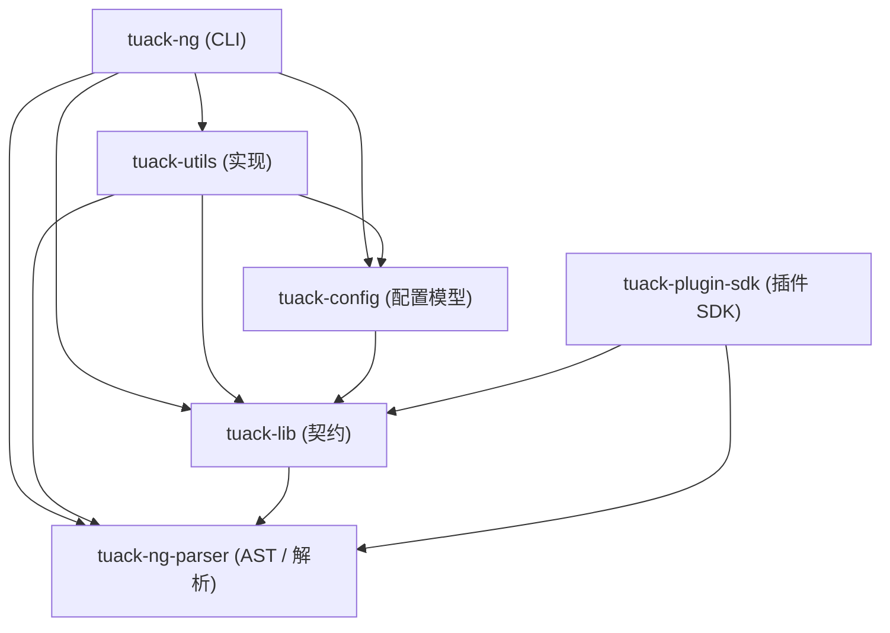

# AGENTS.md

Tuack-NG：OI/ACM 题目开发工具链（Rust，edition 2024）。生成比赛脚手架、渲染题面（Typst PDF / Markdown）、测试题解。

各 crate 的细节见其根目录的 `AGENTS.md`：

- [`tuack-ng`](crates/tuack-ng/AGENTS.md) —— CLI 前端
- [`tuack-lib`](crates/tuack-lib/AGENTS.md) —— 后端契约
- [`tuack-config`](crates/tuack-config/AGENTS.md) —— `conf.json` 数据模型
- [`tuack-utils`](crates/tuack-utils/AGENTS.md) —— 契约实现
- [`tuack-plugin-sdk`](crates/tuack-plugin-sdk/AGENTS.md) —— 插件 SDK
- [`tuack-ng-parser`](crates/tuack-ng-parser/AGENTS.md) —— Markdown 解析器

依赖方向（箭头指向被依赖方；禁止反向依赖）：

## 全局约定

- `AGENTS.md` 只记录改代码时需要注意的约束与坑；用法说明（接口语义、调用方式）属于 rustdoc 与文档，不写在这里。
- 注释规则见 `comment-strategy` skill（`.agents/skills/comment-strategy/SKILL.md`）。
- 写 Issue / Bug 报告用 `issue-report` skill（`.agents/skills/issue-report/SKILL.md`）。
- 输入/输出/答案以流处理，禁止整份读入内存；契约见 [`tuack-lib`](crates/tuack-lib/AGENTS.md)。
- 构建与开发走 `just`（见 `justfile`）：`just build`、`just build-release`、`just run +args=…`、`just unwrap` / `wrap`。
- `cargo test --workspace` 跑 Rust 测试；`tuack-ng test` 测的是题解，两者无关。
- 测试只覆盖本项目自己的契约与行为；验证依赖或标准库是否正常属于上游自己的测试，不写在这里。
- 提交信息与分支选择见 [`CONTRIBUTING.md`](CONTRIBUTING.md)。
